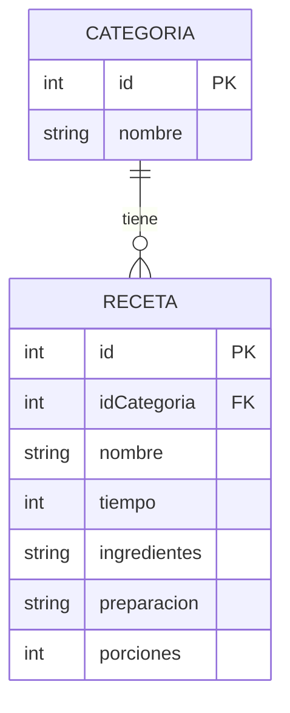

# TP Web — Backend (NestJS)

API REST para una aplicación de recetas de cocina. Expone CRUD para dos entidades relacionadas y es el backend del frontend de este TP.

## Modelo de datos



La foreign key vive en `Receta` (lado N). Los `GET` de recetas devuelven la categoría anidada:

```json
{
  "id": 1,
  "nombre": "Flan casero",
  "tiempo": 60,
  "ingredientes": "Leche, huevos, azúcar",
  "preparacion": "Cocinar a baño maría",
  "porciones": 6,
  "categoria": { "id": 1, "nombre": "Postres" }
}
```

## Stack

NestJS 12, TypeORM, PostgreSQL, `ConfigModule`, `class-validator` / `class-transformer`.

## Requisitos

- Node.js 24
- PostgreSQL local (Docker) o una instancia remota

## Arranco local

```bash
npm install
```

Base de datos local con Docker:

```bash
docker run --name recetas-postgres -e POSTGRES_PASSWORD=secret123! -e POSTGRES_DB=recetas -p 5432:5432 -d postgres:16
```

Crear `.env` en la raíz (no versionado):

```env
DB_HOST=localhost
DB_PORT=5432
DB_USER=postgres
DB_PASSWORD=secret123!
DB_NAME=recetas
```

```bash
npm run start:dev     # http://localhost:3000
```

Si se usa una instancia remota (por ejemplo Render), se puede definir `DATABASE_URL` en lugar de las variables `DB_*`.

## Endpoints

| Método | Ruta | Descripción | Código |
| --- | --- | --- | --- |
| `POST` | `/categorias` | Crear categoría (`{ "nombre": "Postres" }`) | 201 |
| `GET` | `/categorias` | Listar categorías | 200 |
| `GET` | `/categorias/:id` | Obtener una categoría | 200 |
| `PUT` | `/categorias/:id` | Modificar categoría | 200 |
| `DELETE` | `/categorias/:id` | Borrar categoría | 204 |
| `POST` | `/recetas` | Crear receta | 201 |
| `GET` | `/recetas` | Listar recetas | 200 |
| `GET` | `/recetas?categoria=1` | Filtrar recetas por categoría | 200 |
| `GET` | `/recetas/:id` | Obtener una receta | 200 |
| `PUT` | `/recetas/:id` | Modificar receta | 200 |
| `DELETE` | `/recetas/:id` | Borrar receta | 204 |

Body para `POST /recetas` (y `PUT`):

```json
{
  "idCategoria": 1,
  "nombre": "Flan casero",
  "tiempo": 60,
  "ingredientes": "Leche, huevos, azúcar, caramelo",
  "preparacion": "Cocinar a baño maría",
  "porciones": 6
}
```

Se envía `idCategoria` (la FK), no el objeto `categoria`: el DTO solo acepta los campos declarados y `whitelist: true` descarta el resto.

## Validaciones y errores

- `ValidationPipe` global con `whitelist: true`: descarta campos no declarados en los DTO.
- `ParseIntPipe` en los `:id`: un id no numérico responde 400.
- DTOs con `@IsString`, `@IsNotEmpty` y `@IsInt`.
- **400**: body inválido. **404**: el id no existe. **409**: intentar borrar una categoría que tiene recetas; el mensaje indica cuántas y pide borrarlas primero.
- **204** en los `DELETE` (`@HttpCode(204)`).
- `app.enableCors()` en `main.ts` permite consumir la API desde `http://localhost:4200` y desde Netlify.
- El `ETag` de Express está desactivado: evita respuestas `304` que dejaban al `HttpClient` de Angular sin datos.

## Colección de Postman

Importar `postman/coleccion.json`: incluye alta, consulta, modificación y borrado de ambas entidades, el filtro por categoría y los casos de error (400, 404 y 409).

## Estructura

```text
src/
  categorias/   controlador, servicio, DTOs y entidad
  recetas/      controlador, servicio, DTOs y entidad
  app.module.ts ConfigModule y TypeOrmModule
  main.ts       bootstrap, CORS y ValidationPipe
```

## Deploy en Render

- Build command: `npm install && npm run build`
- Start command: `npm run start:prod`
- Variable de entorno: `DATABASE_URL` (o las variables `DB_*`). `PORT` la asigna Render.
- `synchronize: true` crea las tablas al arrancar (práctico para el TP; en producción se usarían migraciones).
- URL desplegada: `https://tp-web-backend-jejw.onrender.com`
- En el plan Free el servicio duerme: la primera request después de un rato puede tardar ~30 s.

## Scripts

`npm run start:dev`, `npm run build`, `npm run start:prod`, `npm run test`.

## Documentación

- [Módulos](https://docs.nestjs.com/modules) · [Controllers](https://docs.nestjs.com/controllers) · [Providers](https://docs.nestjs.com/providers)
- [DTOs y validación](https://docs.nestjs.com/techniques/validation) · [Pipes](https://docs.nestjs.com/pipes) · [Excepciones](https://docs.nestjs.com/exception-filters)
- [TypeORM](https://docs.nestjs.com/recipes/sql-typeorm) · [Configuración](https://docs.nestjs.com/techniques/configuration)
- [Colecciones de Postman](https://learning.postman.com/docs/collections/collections-overview/)
